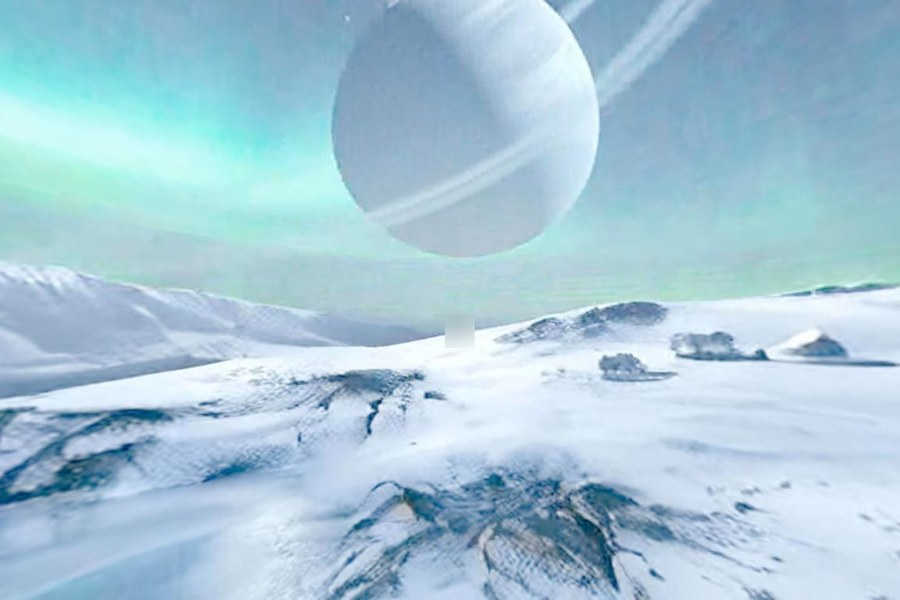
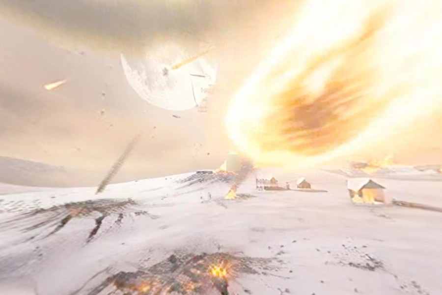
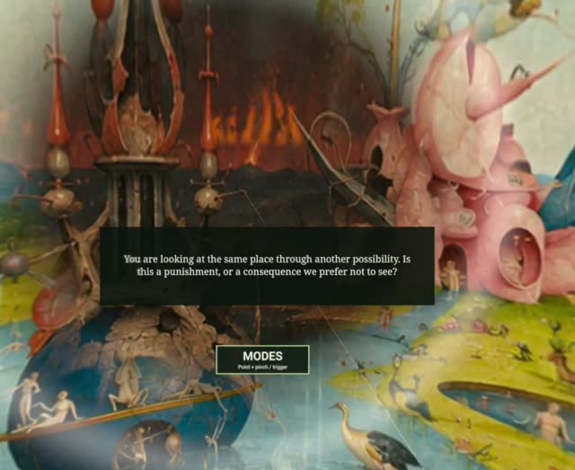
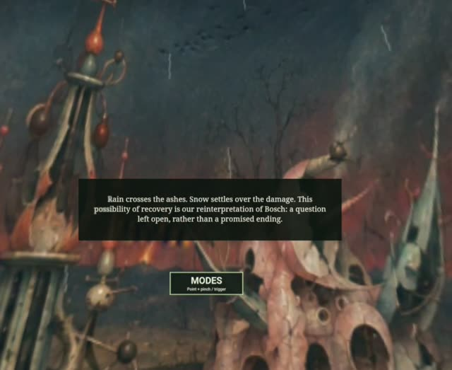
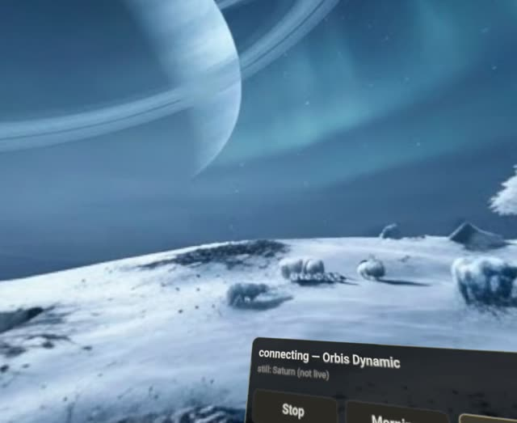
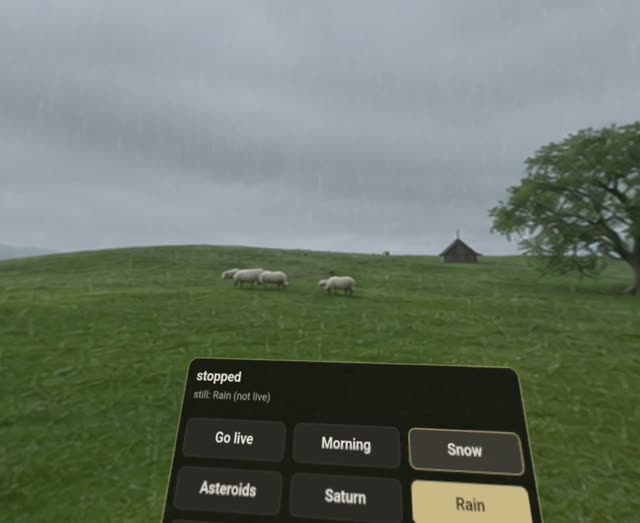
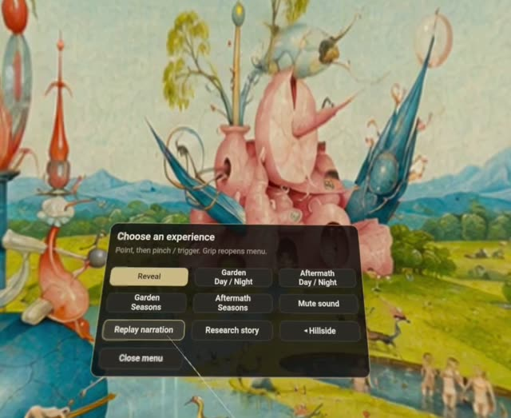
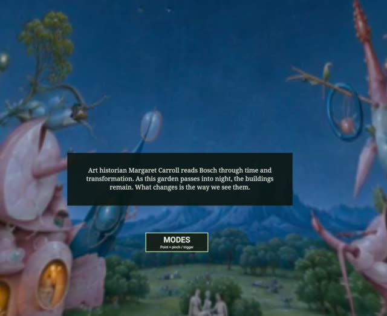

# Paradise

Two 360° worlds in one WebXR page. You stand still; the world around you changes.

- **The Living Hillside** — a panorama generated live. Orbis streams the whole surrounding
  view in real time; a button or a sentence of your own turns the hill into snow under a
  ringed planet, or brings asteroids down on it.
- **The Garden of Consequences** — the storytelling side. Bosch's *Garden of Earthly Delights*
  as a painted world: hold a pinch to reveal the other reading of the same place, walk it
  through day and night and the seasons, with narration and score.

Both run in the same page, on one renderer and one VR session, and you move between them
without taking the headset off.

<table>
  <tr>
    <td></td>
    <td></td>
    <td></td>
    <td></td>
  </tr>
  <tr>
    <td align="center"><sub>Hillside, live — "Saturn"</sub></td>
    <td align="center"><sub>Hillside, live — "Asteroids"</sub></td>
    <td align="center"><sub>Garden — reveal under the ray</sub></td>
    <td align="center"><sub>Aftermath — seasons</sub></td>
  </tr>
</table>

<sub>The two live hillside pictures are screenshots of the page in a desktop browser; the others are frames from a Quest 3 screen recording. All show the running app.</sub>

Built for the **Visko · Living Worlds** track (Orbis real-time video on the Reactor platform),
2026-11-14/15. The project was called *Living Room* while it was being built; the repository
and folder names still say so.

---

## Contents

- [Architecture](#architecture)
- [A 360° world from a 16:9 video model](#a-360-world-from-a-169-video-model)
- [Keeping a generative model on a fixed layout](#keeping-a-generative-model-on-a-fixed-layout)
- [Changing the scene: re-anchor, not steer](#changing-the-scene-re-anchor-not-steer)
- [The relay: no frozen frame](#the-relay-no-frozen-frame)
- [Custom prompts: paint, then direct](#custom-prompts-paint-then-direct)
- [The Garden: one decoder, two worlds](#the-garden-one-decoder-two-worlds)
- [One page, two experiences](#one-page-two-experiences)
- [Input and UI in VR](#input-and-ui-in-vr)
- [Measured numbers](#measured-numbers)
- [Repository layout](#repository-layout)
- [Setup and run](#setup-and-run)
- [Limits](#limits)
- [Credits](#credits)

---

## Architecture

```
                         ┌──────────────────────── browser (WebXR, three.js) ───────────────────────┐
                         │                                                                           │
                         │   shell.js  — ONE WebGLRenderer · ONE canvas · ONE XR session             │
                         │      │  switchTo(): fade to black → deactivate → activate → fade in       │
                         │      ├──────────────────────────────┬──────────────────────────────────── │
                         │      ▼                              ▼                                     │
                         │   The Living Hillside            The Garden of Consequences               │
                         │   liveMain.js · live.js          garden/garden.js · demoModes.js          │
                         │   panoMaterial.js (sphere)       revealMaterial.js (sphere + reveal cap)  │
                         │      ▲            ▲                 ▲                                     │
                         └──────┼────────────┼─────────────────┼─────────────────────────────────────┘
          WebRTC video (2k)     │            │ /api/*          │ static media (Git LFS)
                                │            │                 │
   Reactor ── Orbis Dynamic ────┘      Vite dev server      packed video · posters · audio
   (2 sessions in relay)               · mints scoped JWTs  (2048×2048, two panoramas in one file)
                                       · /api/edit ──► OpenRouter
                                            ├─ image model: paints the new reference (~4 s)
                                            └─ text model:  "prompt director" (what moves / what stays)

   offline, once per scene:  World Labs Marble (text → 2:1 panorama) → tools/pano_reference.py
                             → reference.png 1664×960 (the picture Orbis is anchored to)
```

Two things are deliberately kept off the client: API keys (the dev server holds them and hands
the browser only short-lived, single-model tokens) and every model call that is not the video
stream itself.

---

## A 360° world from a 16:9 video model

Orbis generates ordinary 16:9 video (832×480, delivered at 2560×1440). It has no notion of a
panorama. We make it paint one anyway:

1. **Squash.** A 2:1 equirectangular panorama from Marble is rotated so the interesting part
   is in front, then squeezed horizontally into 16:9 (`tools/pano_reference.py`). That picture
   is the *reference* Orbis starts from.
2. **Generate.** Orbis animates the squashed picture. Because the reference already contains
   the full 360°, every frame it returns is still a (squashed) panorama.
3. **Unsquash on a sphere.** The fragment shader in `web/src/panoMaterial.js` maps view
   direction → longitude/latitude → the frame's UV, stretching it back to 360°×180°.

What makes that hold up in a headset:

| Problem | What the shader does |
|---|---|
| Moving your head must not distort the world | The sphere is head-locked at infinity: the view matrix's translation is dropped and depth is pinned to the far plane (`gl_Position = p.xyww`) |
| The frame's left and right edges meet behind you and do not match exactly | A 3 % cross-blend across the seam, each side mirrored into the other |
| Video models smear the outermost columns | A small edge crop (0.4 %, 1 % for the fallback model) |
| Top and bottom rows are stretched over the poles | The picture fades into a zenith and a nadir colour between 68° and 84°; both colours are re-measured from the live frame twice a second |
| The world should respond to touch although it is infinitely far away | Pointing sends a ripple: a travelling ring that **refracts** the picture (displaces the lookup), up to 8 at once |

<table>
  <tr>
    <td width="50%"></td>
    <td width="50%"></td>
  </tr>
  <tr>
    <td align="center"><sub>The reference as a still, while the stream connects</sub></td>
    <td align="center"><sub>Seconds later: the same place, live</sub></td>
  </tr>
</table>

The still is not a loading screen: it is the same picture the model is about to start from, on
the same sphere, so the hand-over to the stream is a cross-fade between two views of one place.

---

## Keeping a generative model on a fixed layout

The hard part of a live generated *place* is that the model wants to change everything, and a
place is exactly the part that must not change. Everything below was measured on the day
(details and raw numbers in [CLAUDE.md](CLAUDE.md)).

- **Model choice.** Reactor documents Orbis *Stable* and *Dynamic* as the same model. In
  practice only Dynamic keeps the reference: its first frame differed from the reference by
  5.7/255 (mean absolute difference) against 21–38 for Stable, and its camera stayed put;
  Stable re-composed the shot from the first frame under every prompt we tried.
- **A prompt is scene content, not an instruction.** "The camera stays fixed on its tripod"
  put a tripod into the picture and the scene collapsed in ten seconds. Prompts therefore never
  name a camera, a lens, a shot or a viewer.
- **Say what stays, and say what moves.** With "everything stays exactly where it is", asteroids
  painted into the reference simply hung in the sky. With a motion sentence ("burning asteroids
  streak down from upper right to lower left, one after another") they flew — and with the
  word "time-lapse" still in the prompt, smoke buried the hill within 20 s. The working form:

  ```
  frame      A fixed equirectangular 360-degree panorama from the top of a hill: the full
             surrounding view unwrapped into one wide image.
  layout     From left to right: a lake below snowy mountains, the hill crest with sheep …
  stays      The land, the hut and the tree stay exactly where they are.
  moves      Burning asteroids with long bright trails streak down across the sky …
  ambience   A large pale moon hangs in a smoky orange-brown sky …
  ```

- **Drift is managed, not prevented.** However the prompt is written, the layout loosens after
  25–70 s. Rather than fight that, the page returns to the reference on a timer
  ([the relay](#the-relay-no-frozen-frame)).

---

## Changing the scene: re-anchor, not steer

Orbis accepts a new prompt at any time (it lands on the next 33-frame chunk, ~1.8 s, and
settles in 2–4 s). That is fine for a gentle change of light. For a change of *scene* it is not
enough: the picture is anchored to its reference image far more strongly than to its prompt,
and a scene-wide prompt re-composes the panorama and breaks the seam behind the viewer.

So every scene has its own reference image, and a scene change is a **re-anchor**:
`reset → set_image(new reference) → set_prompt → start`. `set_image` only affects the first
chunk of a run, which is why it has to be a new run.

Presets (Morning, Snow, Asteroids, Saturn, Rain) are fixed pairs of a picture and a prompt
written from that picture, in `scenes/hillside/scene.json`. All of them share one layout, so
the hill, the hut and the tree are where you left them when the sky turns into something else.

<p align="center"></p>
<p align="center"><sub>Presets on the in-world panel</sub></p>

---

## The relay: no frozen frame

Re-anchoring one session costs about nine seconds: the stream goes black on `reset` and the
first frames of the new run arrive ~6 s after `start`. Holding a frozen frame for nine seconds,
every 25 seconds, would make the world feel dead a quarter of the time.

Orbis Dynamic can serve two sessions, so the page keeps two and passes the picture between them
(`web/src/live.js`):

```
 session A  ████████████████████ playing ████████████████████▓▓▒▒░░            reset, idle
 session B              idle            reset · set_image · start ░░▒▒▓▓████████ playing ████
                                        └──── warm-up ~8 s ────┘ └ 3 s cross-fade ┘
```

- The line on the sphere keeps playing while the other one is anchored and started.
- When the standby reports frames, the page waits until a few of them have **actually been
  decoded** — the model's "frames emitted" message arrives before the frames do, and fading on
  it would cross-fade into the stale last frame and then pop.
- Then a 3 s, eased, time-based cross-fade from one live video to the other. Each line plays on
  its own `<video>` deck; the outgoing deck is detached after the fade so only one stream is
  decoded outside the hand-over.
- The same hand-over runs on a timer (every ~25 s, to return to the reference before the
  layout drifts) and for every scene change, so pressing "Asteroids" never freezes the hill you
  are standing on: it keeps moving until the asteroids are ready.

If the second session cannot be had, the page runs one line and keeps trying; if Dynamic is
unavailable altogether, it falls back to LingBot World 2 (locked camera, sub-second warm-up,
re-anchored every 40 s) and switches back when Dynamic returns. A session that ends from
outside is noticed and reopened.

---

## Custom prompts: paint, then direct

Typing "asteroids fall from the sky" should not be a hint to the model; it should become a
place. One request to the dev server (`POST /api/edit`, `web/vite.config.js`) does two things
in parallel:

1. **Paint.** An image-editing model (`google/gemini-3.1-flash-lite-image`, via OpenRouter)
   edits the scene's *original* reference into the requested scene, told which things must stay
   where they are and that anything moving must be caught mid-motion. We benchmarked five
   models on our panorama (`tools/image_edit_test.py`): this one took 3–4 s and kept the layout
   best. Always the original reference, never the current scene — stacked edits drift a little
   each time and leave things in the picture that the prompt no longer mentions.
2. **Direct.** A small text model (`anthropic/claude-haiku-5.5`) acts as a prompt director. It
   is given the scene's fixed list and returns structured JSON:

   ```json
   { "moving":   ["asteroids", "fiery trails", "glowing debris"],
     "motion":   "Blazing asteroids streak down from the upper sky toward the lower left, one after another …",
     "ambience": "A smoke-hazed sky glows orange and dim above the mountains …",
     "static_request": false }
   ```

   The answer is not trusted. `lintPrompt()` rejects camera vocabulary, fixed things listed as
   moving, a missing motion sentence and over-long prompts; one retry with the problems fed
   back, then a deterministic fallback.

The result is cached on disk by request text (a repeated request costs nothing and is instant)
and handed to the relay like any preset. End to end: ~4 s to paint, ~8 s warm-up on the second
session while the current scene keeps playing, then the cross-fade.

<p align="center"></p>
<p align="center"><sub>"Asteroids", live in the headset</sub></p>

---

## The Garden: one decoder, two worlds

The storytelling experience (source and production material in
[contributions/bosch-art](contributions/bosch-art/README.md), running in the page from
`web/src/garden/`) solves a different problem: two worlds that must stay frame-accurate with
each other on a standalone headset.

- **Packed video.** Garden and aftermath are two 2048×1024 equirectangular panoramas stacked in
  one 2048×2048 file. One `<video>`, one decoder, one clock: the two worlds cannot drift, and
  the headset never decodes two streams.
- **Angular reveal.** `web/src/revealMaterial.js` opens a spherical cap around the pointing
  ray — measured as an angle on the sphere, not in screen space, so it is round wherever you
  look — and samples the other pane inside it, with a soft rim. One cap per hand.
- **Exact seek and loop.** The file is downloaded whole, checked against its size and SHA-256
  from the manifest, and played from a Blob URL; a plain `src` on a host without Range support
  is not seekable.
- **Modes without a second decoder.** Day/night and seasons are separate clips swapped into the
  *same* video element and texture; the outgoing picture is frozen to a canvas texture so the
  view never goes blank and the head orientation is untouched.
- **Sound.** One music clock, environmental beds mixed by how far the reveal is open, eight
  narration cues, and captions drawn into the world for VR.

<table>
  <tr>
    <td></td>
    <td></td>
    <td></td>
  </tr>
  <tr>
    <td align="center"><sub>In-world mode menu</sub></td>
    <td align="center"><sub>The reveal, with its caption</sub></td>
    <td align="center"><sub>Garden · day / night</sub></td>
  </tr>
</table>

---

## One page, two experiences

A page navigation ends an immersive session; the viewer would be dropped back to the browser
and have to press *Enter VR* again. So the two experiences are not two pages.

`web/src/shell.js` owns the only `WebGLRenderer`, canvas, VR button and XR session. An
experience registers `{ scene, camera, frame(), activate(), deactivate(), ui }`; only the active
one is stepped and rendered.

- **Switching** fades a black sphere in around the active camera (it rides on the camera, so it
  works in the headset), deactivates one side, activates the other, and fades out: 1.2–2 s.
- **An idle experience is really idle.** Leaving the hillside ends its live sessions; leaving
  the Garden pauses its decoder and its sound.
- **Shared controllers.** The XR controllers belong to the renderer, so both experiences listen
  to them; every handler first checks which experience is active, and `activate()` re-parents
  the controllers into its own scene.
- **Preload.** The Garden is fetched a few seconds after the hillside is up and kept paused, so
  the first switch is as quick as the later ones.

---

## Input and UI in VR

- **Pointing, not touching.** The world is at infinity, so interaction is a ray from the
  controller or from a hand pinch (`web/src/pointer.js`). On desktop, drag to look and click to
  point.
- **Panels are canvases.** `web/src/vrPanel.js` draws status and buttons on a 2D canvas, shows
  it on a plane 0.75 m in front of the viewer, and hit-tests rays by UV. A press on the panel
  is consumed before it can become a ripple or a reveal. Grip brings the panel back in front.
- **The page says what it is doing.** The panel's status line reports connecting, generating,
  re-anchoring and which scene is live, because in a headset there is no console.

---

## Measured numbers

| | |
|---|---|
| Orbis generation / delivery | 832×480 → 2560×1440, 17–18 fps |
| First frame after `start` | ~6 s (Dynamic) |
| Prompt change takes effect | next 33-frame chunk (~1.8 s), settles in 2–4 s |
| Reference fidelity, first frame | Dynamic 5.7 / 255 · Stable 21–38 / 255 |
| Layout holds unsteered | 25–70 s, depending on the scene |
| Re-anchor on one session | ~9 s, frozen frame |
| Relay hand-over | ~8 s warm-up in the background, 3 s cross-fade, 0 s frozen |
| Custom prompt, request → new reference | 3–4 s (image) ‖ ~3 s (director) |
| Custom prompt, request → fading in | ~10–12 s |
| Experience switch | 1.2–2 s |
| Garden main video | 2048×2048 packed, 30 fps, 8 s loop, one decoder |

---

## Repository layout

```
web/
  src/shell.js            one renderer + XR session, experience registry, fade switch
  src/liveMain.js         The Living Hillside: sphere, presets, custom prompts, VR panel
  src/live.js             Reactor sessions: connect, re-anchor, relay, fallback, recovery
  src/panoMaterial.js     360° sphere shader: unsquash, seam blend, pole fade, ripples
  src/garden/             The Garden of Consequences (port of the art-side app)
  src/revealMaterial.js   reveal-cap shader shared by the Garden
  src/vrPanel.js          canvas panel with ray hit-testing
  src/pointer.js          controller / hand / mouse rays
  vite.config.js          dev server API: tokens, /api/edit (paint + direct + lint + cache)
  public/garden           → contributions/bosch-art/deployment/bosch-demo/public (symlink)
scenes/hillside/scene.json  model, prompts, presets, fixed list, relay timing
tools/
  marble_pano.py          text → 2:1 panorama (World Labs Marble)
  pano_reference.py       panorama → front still + 16:9 reference; normalises edited scenes
  orbis_test.py           headless Orbis runs with frame capture, layout and seam metrics
  image_edit_test.py      benchmark of image-edit models on a scene reference
  contact_sheet.py        frame sheets for comparing runs
  quest.sh                Quest over USB: adb reverse + dev server
contributions/bosch-art/  the art side: standalone app, media, narration, production scripts, QA
docs/media/               pictures used in this README
.ai/                      architecture notes, decisions and the current hand-off
CLAUDE.md                 platform facts and everything we measured about the models
```

---

## Setup and run

Requirements: Node 20+, Python 3.12 (via `uv`), Git LFS, and for the headset
`android-platform-tools`.

```bash
git lfs install && git lfs pull
cp .env.example .env
cd web && npm install && cd ..
uv venv --python 3.12 tools/.venv && uv pip install --python tools/.venv/bin/python -r tools/requirements.txt reactor-sdk
```

`.env` (never committed) holds `REACTOR_API_KEY` for the video stream, `OPENROUTER_API_KEY` for
custom prompts and `WORLDLABS_API_KEY` for making a new panorama. Optional:
`REACTOR_API_KEY_ALT` for the fallback model.

Scene pictures live outside the repository in `~/Assets/LivingRoom/scenes/<scene>/` and are
symlinked into `web/public/scenes`. To build them for the hillside:

```bash
tools/.venv/bin/python tools/marble_pano.py hillside --world e60f6310-08a9-4e1a-84ab-044b02844ffe
```

```bash
tools/.venv/bin/python tools/pano_reference.py hillside
```

**Desktop** — drag to look, click to ripple, **Go live** to stream:

```bash
npm --prefix web run dev:local
```

Open `http://localhost:5174`. `?exp=garden` opens on the Garden; `?panel=1` shows the VR panel
on desktop.

**Quest 3 over USB** (no LAN or certificate needed): enable developer mode, connect a USB-C
data cable, accept "Allow USB debugging", then

```bash
tools/quest.sh
```

and open `http://localhost:5174` in the headset's browser. The page and its API travel over
USB; the headset needs its own internet for the video stream.

Live sessions are billed per second from the moment they are ready. **Stop**, switching to the
Garden, or closing the tab ends them; the dev server caps any session at 15 minutes.

### Public deployment (recorded)

The public site is built from the `deploy/vercel` branch with `VITE_DEPLOY=1`. It shows the
hillside only and generates nothing: every preset plays a 28-second clip **recorded from Orbis
Dynamic** (`tools/orbis_test.py --mp4`), looped with the same cross-fade the live relay uses
(`web/src/recorded.js`). Typing a custom scene is visible but switched off, and there is no
API and no key in the build. The Garden is a link to its own site.

```bash
tools/.venv/bin/python tools/build_deploy.py hillside   # stills + clips -> web/deploy-public
```

```bash
VITE_DEPLOY=1 npm --prefix web run build
```

---

## Limits

- **A dev server is required for the hillside.** Tokens and custom prompts are served by the
  Vite dev server on the operator's machine; only the Garden is purely static.
- **The loop returns to the reference.** Asteroids fall again and again; a request that implies
  progress ("the hill slowly burns down") does not accumulate.
- **The relay overlaps two 2560×1440 decodes** for a few seconds per hand-over.
- **The image model takes liberties.** It may add things (more sheep, footprints) while keeping
  the layout; the seam behind the viewer is not checked on painted scenes.
- **Typed prompts are entered on the desktop page**; in the headset, the panel offers the
  presets.
- **The Garden's Live Lab is not part of this page.** It remains in the standalone art-side app.

---

## Credits

Built by Qinchuan Zhang (real-time pipeline, WebXR, tooling) and Zoe (art direction,
storytelling, the Garden of Consequences).

Models and services: **Orbis** by Visko on **Reactor** (real-time video) · **Marble** by World
Labs (panorama) · Gemini image editing and Claude Haiku via OpenRouter (custom scenes) ·
LingBot World 2 (fallback) · ElevenLabs (narration voice) · Suno (score).

The Garden draws on Hieronymus Bosch's *The Garden of Earthly Delights*; its narration cites
Margaret Carroll's reading of Bosch through time and transformation, and marks where the
experience extends that reading into its own interpretation. Sources and the distinction between
historical claim and contemporary adaptation are in
[the transcript and credits](contributions/bosch-art/deployment/bosch-demo/public/audio/transcript.en.html).
